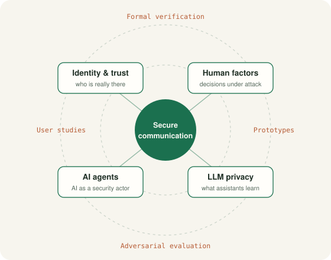

# Securing private communication when people and AI are in the loop

**Md Shahidur Rahaman** · PhD student in Computer Science, Texas A&M University · [SPIES Lab](https://spies.engr.tamu.edu/), advised by [Prof. Nitesh Saxena](https://nsaxena.engr.tamu.edu/)

[Website](https://shahidur60.github.io/shahidur-portfolio/) · [Google Scholar](https://scholar.google.com/citations?user=FexbTskAAAAJ) · [LinkedIn](https://www.linkedin.com/in/md-shahidur-rahaman-02443912a/)

---

End-to-end encryption is mathematically strong. Whether a conversation is actually private, though, also depends on the people using it, the devices around it, and, increasingly, the AI systems that read, summarize, and act inside it. My research studies those boundaries: where secure communication breaks when real people and AI systems become part of it, and how to build defenses that hold up in practice.

## Research directions

### Identity and trust
Encryption guarantees you are talking to *a* key. It does not guarantee the key belongs to the person you meant. I study how identity is established and verified in practice, and what happens when the evidence people rely on can be manipulated.

*Published:* [ISC 2026](#selected-publications), showing that social-media-based identity verification can be defeated by a compromised key server using short-lived fake accounts. Code and study materials: [SocFakeID](https://github.com/Shahidur60/SocFakeID).

### Human factors under attack
Many security decisions are still made by a person looking at a screen. I run controlled, IRB-approved user studies to measure how often people make the safe choice under realistic attack, and design defenses that do not depend on users noticing something is wrong.

### AI agents as security actors
Personal AI agents are starting to act on our behalf, including in security-sensitive tasks. I study how to let agents help without giving a manipulable language model the authority to make security decisions, and I red-team agent designs with adaptive LLM attackers.

### Privacy of AI assistants
When an AI assistant reads a private conversation for one participant, what can it learn about the others? I build evaluations that measure what assistants can infer, and I validate those evaluations against human judgment before trusting them.

Work in progress is described here only at this level. Details, code, and data are released with each publication.

## How I work

| Method | Used for |
|---|---|
| Formal verification | Proving which security properties a protocol design guarantees, and under which assumptions |
| Controlled user studies | Measuring real behavior under attack, with IRB approval |
| Adversarial evaluation | Red-teaming systems, including LLM agents, with scripted and adaptive attackers |
| Working prototypes | Mobile, web, and agent systems that make a defense concrete and testable |
| Evaluation validity | Checking automated metrics against human labels before reporting results ([judge-agreement](tools/judge-agreement)) |

## Impact so far

| | |
|---|---|
| **13** | peer-reviewed publications ([Google Scholar](https://scholar.google.com/citations?user=FexbTskAAAAJ)) |
| **217** | citations, h-index 6 |
| **140+** | participants across user studies I led or contributed to |
| **3M+** | bank customers served by APIs I built before my PhD |
| **7** | undergraduate researchers mentored |

## Selected publications

- M. Alatawi, **M. S. Rahaman** (corresponding author), N. Saxena. *Stress Testing Social Media Authentication Ceremonies of End-to-End Encrypted Messaging with Ephemeral Fake Accounts.* International Conference on Information Security (ISC), 2026.
- A. T. Mahdad, **M. S. Rahaman**, N. Saxena. *TrackAR: AR/VR Device Fingerprinting and User-Device Pairing Detection via Shared Motion Sensor Data.* ACM WiSec, 2026.
- **M. S. Rahaman**, A. Islam, T. Černý, S. Hutton. *Static-Analysis-Based Solutions to Security Challenges in Cloud-Native Systems.* Sensors, 2023. [doi:10.3390/s23041755](https://doi.org/10.3390/s23041755)
- **M. S. Rahaman**, S. N. Tisha, E. Song, T. Černý. *Access Control Design Practice and Solutions in Cloud-Native Architecture: A Systematic Mapping Study.* Sensors, 2023. [doi:10.3390/s23073413](https://doi.org/10.3390/s23073413)

Full list on [Google Scholar](https://scholar.google.com/citations?user=FexbTskAAAAJ).

## Open tools in this repository

- **[judge-agreement](tools/judge-agreement)**: checks whether an automated grader, such as an LLM judge, actually agrees with human labels, using Cohen's kappa with bootstrap confidence intervals. Standard library only, with tests.

## Contact

I am open to research collaborations, internships, and postdoctoral and faculty conversations. Reach me at **mdshahidur_rahaman@tamu.edu**.
